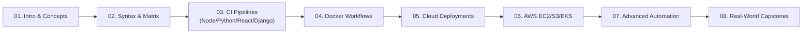

# 🚀 GitHub Actions Mastery - Complete YouTube Series

<p align="center">
  <a href="https://github.com/codewithmuh/github-actions/releases"></a>
  <a href="https://github.com/codewithmuh/github-actions/stargazers"></a>
  <a href="https://github.com/codewithmuh/github-actions/network/members"></a>
  <a href="LICENSE"></a>
  <a href="https://youtube.com/@codewithmuh"></a>
  <br>
  
  
  
</p>

Welcome to the complete GitHub Actions tutorial series! This repository contains all the code, examples, and resources from our comprehensive YouTube playlist covering GitHub Actions from beginner to advanced levels.



## 📺 YouTube Series Overview

This repository is organized to follow along with our YouTube series "GitHub Actions Mastery". Each folder corresponds to a specific video in the series, making it easy to follow along and practice.

## 🎯 What You'll Learn

By the end of this series, you'll master:
- ✅ GitHub Actions fundamentals and core concepts
- ✅ Building robust CI/CD pipelines for multiple tech stacks
- ✅ Docker integration and containerized deployments
- ✅ Cloud deployments (AWS, Kubernetes)
- ✅ Advanced automation and scheduled workflows
- ✅ Real-world project implementations
- ✅ Best practices and security considerations

## 📚 Series Structure

### 🎬 Video 1: Introduction to GitHub Actions
**Folder:** `01-introduction/`
- What are GitHub Actions?
- Key concepts and terminology
- Your first workflow

### 🎬 Video 2: Core Concepts & Workflow Basics
**Folder:** `02-core-concepts/`
- Workflow syntax and structure
- Jobs, steps, and actions
- Different trigger types
- Matrix builds

### 🎬 Video 3: Building CI Pipelines
**Folder:** `03-ci-pipelines/`
- Node.js CI pipeline
- Python application testing
- React app build and test
- Django application CI

### 🎬 Video 4: Docker Integration
**Folder:** `04-docker-workflows/`
- Building Docker images
- Docker Compose in CI
- Image scanning and security
- Multi-stage builds

### 🎬 Video 5: Cloud Deployments
**Folder:** `05-cloud-deployments/`
- Kubernetes deployments
- AWS integrations
- Static site deployments

### 🎬 Video 6: AWS Deployment Strategies
**Folder:** `06-aws-deployments/`
- EC2 deployments
- S3 static hosting
- EKS Kubernetes deployments

### 🎬 Video 7: Advanced Automation
**Folder:** `07-advanced-automation/`
- Scheduled workflows
- Auto-release management
- Issue and PR automation
- Artifact cleanup

### 🎬 Video 8: Real-World Projects
**Folder:** `08-real-world-projects/`
- Full-stack application deployment
- Kubernetes deployment bot
- Slack notification system

## 🚀 Quick Start

1. **Clone the repository:**
   ```bash
   git clone https://github.com/yourusername/github-actions-mastery.git
   cd github-actions-mastery
   ```

2. **Choose your starting point:**
   - New to GitHub Actions? Start with `01-introduction/`
   - Want to jump to a specific topic? Navigate to the relevant folder
   - Each folder has its own README with detailed instructions

3. **Follow along with the videos:**
   - Each folder corresponds to a YouTube video
   - Code examples are ready to use
   - Step-by-step instructions included

## 🛠️ Prerequisites

- Basic Git knowledge
- GitHub account
- Code editor (VS Code recommended)
- Docker (for Docker-related videos)
- Node.js (for JavaScript examples)
- Python (for Python examples)

## 📖 How to Use This Repository

Each video folder contains:
- 📄 `README.md` - Detailed explanation and instructions
- 🔧 `.github/workflows/` - GitHub Actions workflow files
- 💻 Sample application code (when applicable)
- 📝 Additional resources and links

## 🤝 Contributing

Found an issue or want to improve something? Contributions are welcome!

1. Fork the repository
2. Create a feature branch
3. Make your changes
4. Submit a pull request

## 📞 Support & Community

- 🐛 **Issues:** Report bugs or request features in the [Issues](../../issues) section
- 💬 **Discussions:** Join our community discussions
- 📺 **YouTube:** Subscribe to our channel for more DevOps content
- 🐦 **Twitter:** Follow us for updates and tips

## 📄 License

This project is licensed under the MIT License - see the [LICENSE](LICENSE) file for details.

## ⭐ Show Your Support

If this repository helps you learn GitHub Actions, please:
- ⭐ Star this repository
- 👍 Like our YouTube videos
- 🔔 Subscribe to our channel
- 📢 Share with your developer friends

---

**Happy Learning! 🎉**

*Ready to master GitHub Actions? Let's get started with [Video 1: Introduction](01-introduction/)!*